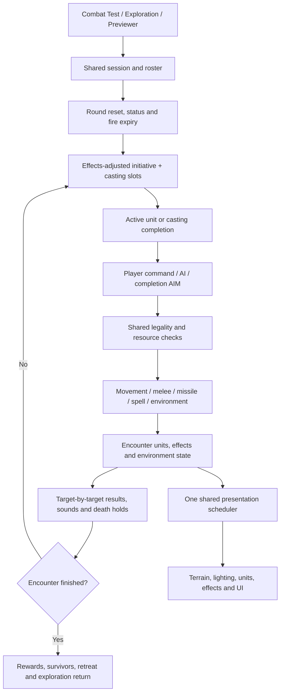

# Combat architecture and extension guide

Local build R238C316. Updated November 12, 2026. Includes the November 5 ownership cleanup and November 12 validation/corpse hardening. These latest changes are local; no remote publication.

## Ownership

| Responsibility | Owner | Inputs and dependencies |
| --- | --- | --- |
| Launch/configuration, shared catalogs and UI bindings | adventure-party.js | Authored data, equipment, UI controls; retains shared bindings |
| Session initialization/results/exit | combat-session-state.js and combat-runtime.js | Scenario/roster, rendering readiness, exploration return; owns encounter transitions |
| Rounds, initiative, active-unit progression | combat-turn-flow.js | Units, status services, casting lifecycle, result holds, shared frame scheduler |
| Casting records and completion | combat-casting-lifecycle.js | Initiative, resource services, legal-target selection; no independent rendering loop |
| Public action admission | longbowAttack/slingAttack/castPreparedCombatSpell in adventure-party.js | Environmental target validity before costs/effects |
| Melee and sweep | combat-melee-actions.js | Explicit result context → melee sound → Slow → perception → physical hit resolver |
| Missile resolution | combat-missile-actions.js | Explicit result context → protection → bow/sling hit resolver; common equipment/ammo and impact services |
| Bow audio | bow-audio.js | Selected CC0 samples share the existing audio context and SFX gain; bow preparation opts in, projectile launch/arrival owns release and misses, missile resolver confirms Flesh after Mirror Image. No extra scheduler. |
| Movement/footprints/pathfinding | combat-movement.js | Occupancy and wall/door geometry; reactions before movement commit; area effects/guards afterward |
| Opportunity attacks, Guard/Ranged Ambush | combat-reactions.js | Existing reach and previous-target rules, shared attack entry points |
| Prepared-spell orchestration | combat-spell-actions.js | Sound → caster focus → completion cleanup → casting context → dispatch |
| Spell families | combat-spells-damage.js, combat-spells-control.js, combat-spells-support.js | Existing spell commit/resource and result services; level-3 extensions remain named registered stages |
| Persistent environment | combat-environment-state.js, combat-environment-actions.js | Doors/windows, blocked edges, scorch, arrows and fire lifecycle; shared encounter data |
| Visibility | combat-visibility.js | Friendly observers, geometry, fog; CPU gameplay authority |
| Targeting/area selection | combat-targeting.js | Visibility and projectile obstruction; intact glass remains visible but untargetable beyond it |
| Frame composition | combat-render-frame.js | Read presentation state, queue terrain/actors/effects through shared scheduler |
| Terrain/architecture and unit drawing | combat-render-surfaces.js, combat-render-units.js | Lighting/exposure, assets and projection; drawing does not decide attack legality |
| Lighting and effects | combat-lighting-services.js, combat-effect-animation.js | Shared light/effect sources, shader backend and existing animation scheduler |
| GPU resources | combat-webgl.mjs and existing specialized renderers | WebGL 2, geometry, sampling/compositing; no combat-rule ownership |
| Legacy extension composition | combat-services.js | Named ordered stages, stable facades and captured previous implementations |

## Persistent combat loop

## Service boundaries and remaining shared state

This is a classic-script modularization, not a conversion to isolated ES modules. The game, terrain, catalogs, UI and presentation bindings still share the existing engine scope. Ownership is explicit; complete dependency injection is not claimed. The extraction audit in combat-module-manifest.json records 208 function bodies and their owners. Tests verify unique ownership and parseability; the original extraction hashes are historical records. Behavioral regressions cover subsequent feature changes.

Legacy extensions now call AdventurePartyCombatServices.register(name, stageId, implementation). A stage captures its predecessor using current(name), never the live public facade. Registration preserves original manifest order, detects duplicate IDs and keeps public identity stable after first registration. inspect() exposes the installed order for diagnostics. combat-service-stages.json inventories the 198 migrated stages across 125 services. These stages retain their historical closures; the registry does not pretend their implementation dependencies have disappeared.

Primary turn, missile, spell orchestration and casting transitions use direct named calls. Prefer a direct owner change for new work. Use a registered stage only where a genuine extension boundary is needed; never add another bare function reassignment. Do not capture the facade as a predecessor or install a new frame loop.

## Adding features

- New weapon: use equipment/catalog and shared eligibility/ammunition rules; enter the existing melee or missile action owner.
- New spell: add its resolver to the appropriate family and dispatch through the prepared-spell owner. Keep AI, battlefield and Previewer on the same production path.
- New environment object: persistent encounter state belongs to the environment owner; separately define movement, sight, targeting and presentation behavior.
- New visual: read the existing scene/effect state and use the shared frame scheduler. CPU LOS/targeting remains authoritative.
- New encounter route: feed a scenario to startCombatSession; do not fork combat initialization or result handling.

## Validation

Use Node 24 (.node-version) and node scripts/run-combat-regressions.mjs. The runner discovers combat, Workshop, bow/arrow, racial and related regression families; new matching tests enter CI automatically. The current suite has 76 tests. scripts/test-validation-workflow.mjs guards YAML command boundaries and suite inclusion. The remaining validation workflow commands cover Studio, assets and exploration. The old work/run-cleanup-tests.cjs report records the historical November 5 sweep. New core checks include test-combat-module-boundaries, test-combat-turn-flow, test-combat-casting-lifecycle, test-combat-spell-actions, test-combat-missile-actions and test-combat-action-entry. Legacy extraction tests read current owners through scripts/combat-test-source.mjs rather than retaining dead copies in the main file. Startup validation uses the real ordered manifest. Isolated owner tests declare camera/audio dependencies in scripts/combat-presentation-test-context.mjs and browser image decoding/notifications in scripts/combat-image-test-context.mjs; production bow audio, camera movement and ordered startup still have separate behavioral tests.

Two final-suite issues were resolved separately: Falling correctly borrows the documented one-handed Ready pose; Wizard Staff explicitly refuses implicit weapon-pose fallback. Sprite-package temporary files now live in the workspace, and its path-safety test uses a Windows junction (directory symlink on other systems). Windows sandbox policy can still require running that one fixture outside the sandbox; no safety assertion is skipped.

Browser validation results and final test totals are recorded in COMBAT_CLEANUP_CHECKPOINT.md. Player visual QA and publishing are separate from automated/browser smoke validation.

### Shared projected shadows (local prototype, 2026-11-05)

See PROJECTED_SHADOWS.md. combat-projected-shadows.mjs is a renderer-owned GPU pass; lighting services adapt physical casters/emitters, unit-sun-shadow supplies cached alpha/foot contacts, and the frame owner schedules ground shadows before scenery. CPU gameplay visibility/targeting remains authoritative.

### Settled corpse presentation (November 12, R238C316)

- combat-direct-units.mjs keeps one final geometry pose per entity/death/source, preserves registered shadow LODs in that pose, and supplies a complete image key to the GPU owner. Animation and gameplay rules are unchanged.
- combat-unit-image-cache.mjs retains final body images with an LRU limit of 64 entries and 64 MiB estimated color/depth/MSAA storage. combat-webgl.mjs owns targets, composition, eviction and disposal; encounter changes/context loss clear the cache. Oversize entries use the normal render path.
- Keys include the final pose/view, dimensions, crop/resolution/MSAA, solar and local lights, ambient, opacity, charring and snow amount/color. Changed keys refresh once. Burning reactions and flaming weapons use the animated path. Shadows retain their existing dynamic projection.
- Bare corpses register accumulation immediately but defer exposure-mask baking until snow first lands. They skip terrain snow-light queries; snow color conversion runs once per body render. Snow accumulation, melting and clearing invalidate retained images. No new scheduler or gameplay visibility authority.
- scripts/test-combat-corpse-performance.mjs covers posed shadow budgets, no settled resampling, retained-target reuse/eviction/disposal, view/light/snow invalidation and resurrection/replacement. It also exercises production lighting to require zero snow-light queries for bare bodies.
- Optional live check: with the local game server running, run node scripts/profile-combat-corpses.cjs. Provide PLAYWRIGHT_MODULE and BROWSER_EXECUTABLE when Playwright/Chromium are not on their defaults; GAME_BASE_URL defaults to http://127.0.0.1:8276/. This uses an isolated headless browser, saves numeric results to .local/corpse-profile.json, and never touches the user's open game. It compares the same 12 models alive/dead and requires cache refresh/reuse after snow/melt/clear, lighting, rotation and zoom.

Measured local Chrome check (1600x1000, grassy battlefield, 12 settled Carl copies plus one living character): model passes fell from 13/frame to 1/frame; retained-body hits were 12/frame. Model CPU submission fell from about 0.90 ms before to 0.09–0.10 ms after. Total submission was about 19.7 ms before versus 16.6–17.3 ms after in these samples. Both runs remained at the existing 30 FPS cap; these numbers do not promise an FPS gain in every encounter. Cache used 6,367,680 bytes after zoom testing; no page errors. Full visual QA remains with the user.

### Local R238C322 — display submission optimization (2026-11-12)
CPU sampling identified repeated Canvas clip construction and exhaustive indoor-space queries as major recurring costs. clipExplorationFloor now retains one Path2D keyed by spaces identity/length and the exact camera projection. Architectural space queries retain up to 8,192 exact point results, including misses; encounter geometry replacement or length changes discard them. The terrain/session owners replace architecturalSpaces rather than editing its polygons in place. Future in-place geometry editors must explicitly clear architecturalSpaceAtWorldPoint.cache and clipExplorationFloor.cache (or replace the spaces array). Original polygon predicate and reverse overlap priority remain authoritative. Canvas adapter method wrappers are also retained rather than allocated on every method access; flush/backdrop semantics are unchanged.

Seeded Chrome 1600x1000, same terrain/camera/12 models plus player, 100 measured frames after 35 warmup frames: living submission 14.288 -> 8.719 ms (39.0% lower); corpse submission 13.926 -> 8.480 ms (39.1% lower). Terrain CPU 5.075 -> 2.489 ms. Floor triangles remained 2,628 and corpse-scene composite draws remained 39. Retained corpse targets remain 9,551,520 bytes, with 12 cache hits/frame. Both builds remained at the existing 30 FPS cap. This is scene-specific CPU headroom, not a universal FPS claim. Baseline/after reports: .local/display-r322-baseline.json and .local/display-r322-after.json.

Validation: 81/81 combat/Workshop regressions passed. Browser checks retained correct invalidation for three snow layers, melt/clear, light, rotation and zoom. 24 pixel-exact clipping comparisons (grass/wall, six rotations, two camera positions) matched the original immediate Canvas path; live frames had no rendering errors. New scripts/profile-combat-display.cjs uses deterministic seed 322 and accepts optional CPU_PROFILE output; scripts/probe-combat-display-clipping.cjs performs the pixel checks. Same PLAYWRIGHT_MODULE / BROWSER_EXECUTABLE environment conventions as the corpse profiler. No visual previews or remote publication; user visual QA pending.
