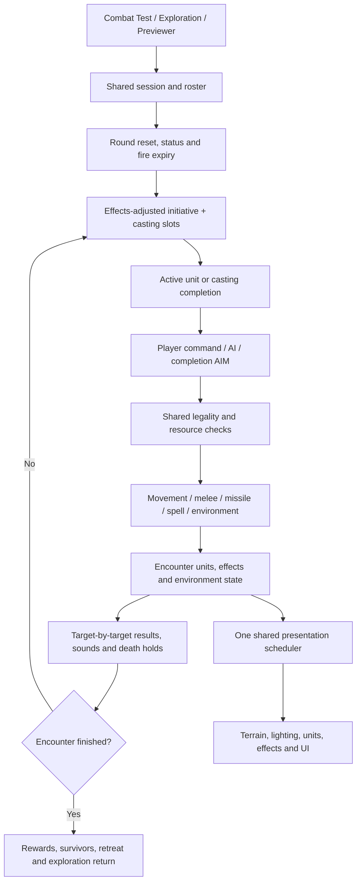

# Combat architecture and extension guide

Local build R238C316. Updated November 12, 2026. Includes the November 5 ownership cleanup and November 12 validation/corpse hardening. These latest changes are local; no remote publication.

## Ownership

| Responsibility | Owner | Inputs and dependencies |
| --- | --- | --- |
| Launch/configuration, shared catalogs and UI bindings | adventure-party.js | Authored data, equipment, UI controls; retains shared bindings |
| Session initialization/results/exit | combat-session-state.js and combat-runtime.js | Scenario/roster, rendering readiness, exploration return; owns encounter transitions |
| Rounds, initiative, active-unit progression | combat-turn-flow.js | Units, status services, casting lifecycle, result holds, shared frame scheduler |
| Casting records and completion | combat-casting-lifecycle.js | Initiative, resource services, legal-target selection; no independent rendering loop |
| Public action admission | longbowAttack/slingAttack/castPreparedCombatSpell in adventure-party.js | Environmental target validity before costs/effects |
| Melee and sweep | combat-melee-actions.js | Explicit result context → melee sound → Slow → perception → physical hit resolver |
| Missile resolution | combat-missile-actions.js | Explicit result context → protection → bow/sling hit resolver; common equipment/ammo and impact services |
| Bow audio | bow-audio.js | Selected CC0 samples share the existing audio context and SFX gain; bow preparation opts in, projectile launch/arrival owns release and misses, missile resolver confirms Flesh after Mirror Image. No extra scheduler. |
| Movement/footprints/pathfinding | combat-movement.js | Occupancy and wall/door geometry; reactions before movement commit; area effects/guards afterward |
| Opportunity attacks, Guard/Ranged Ambush | combat-reactions.js | Existing reach and previous-target rules, shared attack entry points |
| Prepared-spell orchestration | combat-spell-actions.js | Sound → caster focus → completion cleanup → casting context → dispatch |
| Spell families | combat-spells-damage.js, combat-spells-control.js, combat-spells-support.js | Existing spell commit/resource and result services; level-3 extensions remain named registered stages |
| Persistent environment | combat-environment-state.js, combat-environment-actions.js | Doors/windows, blocked edges, scorch, arrows and fire lifecycle; shared encounter data |
| Visibility | combat-visibility.js | Friendly observers, geometry, fog; CPU gameplay authority |
| Targeting/area selection | combat-targeting.js | Visibility and projectile obstruction; intact glass remains visible but untargetable beyond it |
| Frame composition | combat-render-frame.js | Read presentation state, queue terrain/actors/effects through shared scheduler |
| Terrain/architecture and unit drawing | combat-render-surfaces.js, combat-render-units.js | Lighting/exposure, assets and projection; drawing does not decide attack legality |
| Lighting and effects | combat-lighting-services.js, combat-effect-animation.js | Shared light/effect sources, shader backend and existing animation scheduler |
| GPU resources | combat-webgl.mjs and existing specialized renderers | WebGL 2, geometry, sampling/compositing; no combat-rule ownership |
| Legacy extension composition | combat-services.js | Named ordered stages, stable facades and captured previous implementations |

## Persistent combat loop

## Service boundaries and remaining shared state

This is a classic-script modularization, not a conversion to isolated ES modules. The game, terrain, catalogs, UI and presentation bindings still share the existing engine scope. Ownership is explicit; complete dependency injection is not claimed. The extraction audit in combat-module-manifest.json records 208 function bodies and their owners. Tests verify unique ownership and parseability; the original extraction hashes are historical records. Behavioral regressions cover subsequent feature changes.

Legacy extensions now call AdventurePartyCombatServices.register(name, stageId, implementation). A stage captures its predecessor using current(name), never the live public facade. Registration preserves original manifest order, detects duplicate IDs and keeps public identity stable after first registration. inspect() exposes the installed order for diagnostics. combat-service-stages.json inventories the 198 migrated stages across 125 services. These stages retain their historical closures; the registry does not pretend their implementation dependencies have disappeared.

Primary turn, missile, spell orchestration and casting transitions use direct named calls. Prefer a direct owner change for new work. Use a registered stage only where a genuine extension boundary is needed; never add another bare function reassignment. Do not capture the facade as a predecessor or install a new frame loop.

## Adding features

- New weapon: use equipment/catalog and shared eligibility/ammunition rules; enter the existing melee or missile action owner.
- New spell: add its resolver to the appropriate family and dispatch through the prepared-spell owner. Keep AI, battlefield and Previewer on the same production path.
- New environment object: persistent encounter state belongs to the environment owner; separately define movement, sight, targeting and presentation behavior.
- New visual: read the existing scene/effect state and use the shared frame scheduler. CPU LOS/targeting remains authoritative.
- New encounter route: feed a scenario to startCombatSession; do not fork combat initialization or result handling.

## Validation

Use Node 24 (.node-version) and node scripts/run-combat-regressions.mjs. The runner discovers combat, Workshop, bow/arrow, racial and related regression families; new matching tests enter CI automatically. The current suite has 76 tests. scripts/test-validation-workflow.mjs guards YAML command boundaries and suite inclusion. The remaining validation workflow commands cover Studio, assets and exploration. The old work/run-cleanup-tests.cjs report records the historical November 5 sweep. New core checks include test-combat-module-boundaries, test-combat-turn-flow, test-combat-casting-lifecycle, test-combat-spell-actions, test-combat-missile-actions and test-combat-action-entry. Legacy extraction tests read current owners through scripts/combat-test-source.mjs rather than retaining dead copies in the main file. Startup validation uses the real ordered manifest. Isolated owner tests declare camera/audio dependencies in scripts/combat-presentation-test-context.mjs and browser image decoding/notifications in scripts/combat-image-test-context.mjs; production bow audio, camera movement and ordered startup still have separate behavioral tests.

Two final-suite issues were resolved separately: Falling correctly borrows the documented one-handed Ready pose; Wizard Staff explicitly refuses implicit weapon-pose fallback. Sprite-package temporary files now live in the workspace, and its path-safety test uses a Windows junction (directory symlink on other systems). Windows sandbox policy can still require running that one fixture outside the sandbox; no safety assertion is skipped.

Browser validation results and final test totals are recorded in COMBAT_CLEANUP_CHECKPOINT.md. Player visual QA and publishing are separate from automated/browser smoke validation.

### Shared projected shadows (local prototype, 2026-11-05)

See PROJECTED_SHADOWS.md. combat-projected-shadows.mjs is a renderer-owned GPU pass; lighting services adapt physical casters/emitters, unit-sun-shadow supplies cached alpha/foot contacts, and the frame owner schedules ground shadows before scenery. CPU gameplay visibility/targeting remains authoritative.

### Settled corpse presentation (November 12, R238C316)

- combat-direct-units.mjs keeps one final geometry pose per entity/death/source, preserves registered shadow LODs in that pose, and supplies a complete image key to the GPU owner. Animation and gameplay rules are unchanged.
- combat-unit-image-cache.mjs retains final body images with an LRU limit of 64 entries and 64 MiB estimated color/depth/MSAA storage. combat-webgl.mjs owns targets, composition, eviction and disposal; encounter changes/context loss clear the cache. Oversize entries use the normal render path.
- Keys include the final pose/view, dimensions, crop/resolution/MSAA, solar and local lights, ambient, opacity, charring and snow amount/color. Changed keys refresh once. Burning reactions and flaming weapons use the animated path. Shadows retain their existing dynamic projection.
- Bare corpses register accumulation immediately but defer exposure-mask baking until snow first lands. They skip terrain snow-light queries; snow color conversion runs once per body render. Snow accumulation, melting and clearing invalidate retained images. No new scheduler or gameplay visibility authority.
- scripts/test-combat-corpse-performance.mjs covers posed shadow budgets, no settled resampling, retained-target reuse/eviction/disposal, view/light/snow invalidation and resurrection/replacement. It also exercises production lighting to require zero snow-light queries for bare bodies.
- Optional live check: with the local game server running, run node scripts/profile-combat-corpses.cjs. Provide PLAYWRIGHT_MODULE and BROWSER_EXECUTABLE when Playwright/Chromium are not on their defaults; GAME_BASE_URL defaults to http://127.0.0.1:8276/. This uses an isolated headless browser, saves numeric results to .local/corpse-profile.json, and never touches the user's open game. It compares the same 12 models alive/dead and requires cache refresh/reuse after snow/melt/clear, lighting, rotation and zoom.

Measured local Chrome check (1600x1000, grassy battlefield, 12 settled Carl copies plus one living character): model passes fell from 13/frame to 1/frame; retained-body hits were 12/frame. Model CPU submission fell from about 0.90 ms before to 0.09–0.10 ms after. Total submission was about 19.7 ms before versus 16.6–17.3 ms after in these samples. Both runs remained at the existing 30 FPS cap; these numbers do not promise an FPS gain in every encounter. Cache used 6,367,680 bytes after zoom testing; no page errors. Full visual QA remains with the user.

### Local R238C322 � display submission optimization (2026-11-12)
CPU sampling identified repeated Canvas clip construction and exhaustive indoor-space queries as major recurring costs. clipExplorationFloor now retains one Path2D keyed by spaces identity/length and the exact camera projection. Architectural space queries retain up to 8,192 exact point results, including misses; encounter geometry replacement or length changes discard them. The terrain/session owners replace architecturalSpaces rather than editing its polygons in place. Future in-place geometry editors must explicitly clear architecturalSpaceAtWorldPoint.cache and clipExplorationFloor.cache (or replace the spaces array). Original polygon predicate and reverse overlap priority remain authoritative. Canvas adapter method wrappers are also retained rather than allocated on every method access; flush/backdrop semantics are unchanged.

Seeded Chrome 1600x1000, same terrain/camera/12 models plus player, 100 measured frames after 35 warmup frames: living submission 14.288 -> 8.719 ms (39.0% lower); corpse submission 13.926 -> 8.480 ms (39.1% lower). Terrain CPU 5.075 -> 2.489 ms. Floor triangles remained 2,628 and corpse-scene composite draws remained 39. Retained corpse targets remain 9,551,520 bytes, with 12 cache hits/frame. Both builds remained at the existing 30 FPS cap. This is scene-specific CPU headroom, not a universal FPS claim. Baseline/after reports: .local/display-r322-baseline.json and .local/display-r322-after.json.

Validation: 81/81 combat/Workshop regressions passed. Browser checks retained correct invalidation for three snow layers, melt/clear, light, rotation and zoom. 24 pixel-exact clipping comparisons (grass/wall, six rotations, two camera positions) matched the original immediate Canvas path; live frames had no rendering errors. New scripts/profile-combat-display.cjs uses deterministic seed 322 and accepts optional CPU_PROFILE output; scripts/probe-combat-display-clipping.cjs performs the pixel checks. Same PLAYWRIGHT_MODULE / BROWSER_EXECUTABLE environment conventions as the corpse profiler. No visual previews or remote publication; user visual QA pending.

## Local audit R238C357 (2026-11-12)

Scope: current uncommitted combat display/snow, contextual grid/input, and Elf AI changes. This is a focused change audit, not a complete repository security or performance certification.

Findings and corrections:
- Removed abandoned ground-to-corpse synchronization and its unused ground-coverage reader. Its test had kept passing after gameplay stopped using the path. The replacement tests fresh corpses on fully covered ground, four timed layers, independent whitening, melt, and revival cleanup.
- Restored committed newline conventions. The apparent tracked diff fell from roughly 28,000 inserted/deleted lines to hundreds without reverting gameplay changes.
- The recent Space crash and instant corpse coating demonstrated an integration-test gap. Added a single browser regression runner for the real runtime paths; keep this alongside the unit suite for rendering changes.

Current ownership: ground grain/depth fields remain in combat-snow/coats; corpse deposition uses its own elapsed snowfall clock; corpse body whitening is derived from its own snow amount; heat expiry belongs to encounter rounds. Hot grains are bounded transient presentation, not persistent snow deposits. Preserve these boundaries. Foot-trail storage/cap is unchanged as requested.

Validation: 96/96 combat regressions and all six browser checks passed (Space-start grid, snow controls, fireball with active snowfall/fresh corpse, GPU opacity/local light, static/skinned snow burial, destination movement). No screenshots delivered; visual acceptance remains with the user.

Repeatable checks from repository root:
- node scripts/run-combat-regressions.mjs
- node scripts/run-combat-browser-regressions.cjs (local server on 8276; PLAYWRIGHT_MODULE and BROWSER_EXECUTABLE configured)

Remaining maintenance risks: bow accuracy prediction duplicates attack inputs; heat collection currently refreshes state during rendering; a large fireball's gradient rebuild/upload has not been benchmarked under worst-case map sizes. Prefer small shared-rule/lifecycle refactors with integration tests, not a wholesale combat rewrite. No remote publication.

## Targeted cleanup R238C358 (2026-11-12)

- `bowAttackRollInputs` in combat-missile-actions.js now owns bow accuracy inputs for both real attacks and Elf AI probability evaluation. It is read-only. Explicit owner fixtures load that helper rather than duplicating or mocking its formula.
- Tree neighbor heat is refreshed on ignition and round advancement. Expired records are pruned during round updates; combatGroundHeat is a read-only filtered query. Steam lifetime updates run on the existing transient FX tick, outside rendering. No new loop.
- Feather distance uses squared distances and early rejection, with one square root per affected texel instead of per candidate rectangle. Full output bytes match the prior algorithm at tested radii, including deep snow and non-unit projection squash.

CPU benchmark: 61 affected hexes, 441-hex synthetic map, three samples per resolution, median milliseconds (gradient computation plus CPU upload-array construction; excludes GPU transfer and frame time):

| Texture | Before | After |
| --- | ---: | ---: |
| 512 squared | 19.1 | 6.0 |
| 1024 squared | 132.3 | 68.1 |
| 2048 squared | 628.9 | 171.6 |

Reproduce using `node scripts/benchmark-combat-snow-feather.mjs`. These are local measurements, not FPS guarantees. Large/high-resolution melts may still hitch; GPU upload remains a separate future measurement target.

Validation: 96/96 combat regressions; 6/6 real-browser checks; added explicit ignition/round-expiry/read-only-render checks and reference-gradient byte equivalence tests. All changes remain local.

### Ground cover (local R238C360)

`combat-ground-cover.mjs` owns presentation-only instance placement, curved blades, stones, branches, wind and snow burial. The floor renderer collects eligible faces; `combat-render-frame.js` prepares visible batches and draws successive root-depth intervals around the existing ordered actors. Movement/LOS/terrain rules stay unchanged. Reuse the floor exposure map, shared snow depth/shelter/cuts, shader wind and the existing scheduler. No per-blade objects or per-frame geometry generation. Root ordering is an approximation for low cover, not a shared per-pixel unit/terrain depth buffer. See the R238C360 checkpoint and ground-cover CPU/GPU tests before extending this system.

R238C366 grass asset trial: the grass batch asynchronously replaces its procedural template with locally vendored CC0 Poly Haven Grass Medium 01 geometry plus diffuse/alpha/normal textures; stones/sticks stay procedural. Asset provenance and geometry preparation are recorded in `assets/models/ground-cover/polyhaven-grass-medium-01/source.json`. Keep the ready promise, fallback diagnostics, disposal guards, original UVs, and shared lighting/snow bindings when revising the asset. The GPU probe must await asset readiness, so a successful fallback render cannot masquerade as a successful import.

R238C369 supersedes the sparse grass trial with complete authored large_a LOD1/LOD2 from the original Blender asset, preserving UVs/normals and uniform proportions. Imported vertical projection converts metres using root scale and camera squash before both snow-height comparison and screen elevation. Keep bounded alpha smoothing with near-zero discard to avoid black atlas fringes. The original roughness map and approximate leaf transmission supplement the custom shader; this is not full Blender PBR. Source manifest documents exports and texture provenance; checkpoint records regression and performance results.

R238C370: user rejected the Poly Haven trial; runtime is restored to the pre-import procedural renderer. R238C366/R238C369 asset/material instructions above are historical, not current runtime behavior. Preserve existing placement density, half-size grass/stones and triple tufts. The unused source assets retain provenance.

R238C371 refines procedural grass using independent neighboring-tuft seeds, twisted/tapered curved blades and softer two-sided foliage lighting. Central fold shading is analytic rather than added geometry. Retains R238C370 procedural runtime and existing triangle budgets; no imported foliage atlas. See checkpoint for focused validation.

R238C372: ground-cover instance storage is now a 256-wide growable RGBA float texture (128 two-texel instance records per row), not a 2x8192 fixed-height texture. Never truncate the sorted visible rows: shader indexing and CPU upload must remain aligned. The standalone grass-scatter-test.html lab includes a static six-foot Orc reference, actual terrain textures, optional tuning and nonblocking performance counters. Game tuning defaults remain unchanged.

R238C373: shared GROUND_COVER_DEFAULTS is the approved two-tuft preset and is reused by the lab. Placement cache records now hold ephemeral sort/visibility and revision-keyed shelter samples; do not share these mutable records between renderer instances. Packed float comparisons gate uploads. Grass templates omit only zero-area tip triangles. Preserve shelter invalidation and all ordered actor boundaries when optimizing further.

R238C385: scatter layout lists persist across frames. Numeric snapshots invalidate for camera/viewport/zoom, grass-face coordinates/visibility/scale and canopy shelter revision; scene() invalidates explicitly. Dynamic uniforms remain live even when layoutReused is true. Extend this snapshot whenever adding another input that changes instance selection/order.

### R238C386 - VFX efficiency

Fireball targets use 64-pixel-aligned effect bounds with 50px blur padding.
Body/sparks retain full resolution; glow targets use half resolution with the
original world-pixel blur radius. Only active shape vertices are uploaded.
Offscreen/transparent smoke skips rendering and the preceding batch flush.
Tree snow coverage invalidates its own entry, not the entire tree image cache.
Corpse cache dependencies and empty-outline rejection were audited and retained.
Local RTX 3070 Chrome isolated 1600x1000 blast: median GPU 0.73ms -> 0.076ms,
CPU ~0.10ms unchanged. Center, edge, offscreen and zoom pixel comparisons differ
by at most 2/255 per channel. This is not a whole-frame FPS claim.
Combat regression suite: 101/101 passed before added cache regression.

Local R238C388: `combat-lighting-profile.mjs` owns shared direct-unit highlight/material controls for combat and `lighting-lab.html`. Physical model radiance and corpse snow display color use separate hue-preserving knees; do not apply a physical-radiance knee to inverse-encoded snow display color. Profile uniforms must be reconstructed after prepared-asset JSON hydration. Default profile is frozen/reused; overrides are lab-only draw options and participate in corpse image-cache invalidation.

R238C390: procedural grass uses analytic pixel coverage. Cached template cross-sections/tangents follow the existing wind/bending transforms; the vertex shader pads ribbon sides by half a physical viewport pixel and the fragment shader weights true projected coverage. Keep renderer.getCurrentViewport sizing (including DPR/targets), zero-width tips, both LODs, actor/corpse ordering and shared snow masks. No separate antialiasing render pass or history buffer. tuning.edgeAntialiasing=false is an isolated A/B diagnostic; the game and grass lab default on. The GPU scrolling fixture compares subpixel camera steps to an 8x reference and checks cover behavior plus unchanged draw/triangle budgets. This corrects missing thin-blade coverage, which can make tufts look fuller without changing density.

R238C391 supersedes R238C388's total snow-color compression and inverse display encoding. Corpse caps receive terrain-tinted ambient display RGB directly (corpseSnowGroundDisplay), bypass model tone mapping for that baseline, and bound only the extra point-light contribution. Preserve exact ambient equality, low-light color, independent body whitening and display-space partial alpha. The cap uses the existing pass/composite/cache path; scene lighting and snow simulation remain unchanged. The production snow-ambient GPU fixture checks floor-versus-cap pixels through the real compositor, bright/no-lamp ambient equality, extreme night lamps, partial opacity and both target formats. Lighting lab comparison now disables highlight limits only; its optional background is an explicitly labeled ambient snow reference.

### Ground-cover scrolling cache repair (2026-11-15)
Measured oak crown x/sortY cancellation noise (~5.68e-14) invalidated resident cover layouts during camera pans. Only projected crown/corpse snapshot coordinates now tolerate 1e-8 difference from the retained snapshot. Rotation matrices, terrain geometry, visibility, exclusions and shelter revisions retain exact invalidation. No density reduction or new render pass. Reused frames retain GPU root textures; camera/wind/snow remain shader-driven. A 24-frame fall-season pan with 100,139 instances improved from 22 rebuilds / 38.83 ms average CPU prepare to 8 rebuilds / 14.69 ms on the local hidden-browser run. These are prepare timings, not whole-frame FPS or GPU measurements; rebuild spikes remain. Grass-pan, ground-cover and grass-scatter tests pass, including subpixel cancellation versus real crown movement.

### Snow/terrain GPU refinement (2026-11-15)
Refined homogeneous outdoor floor batches now upload compact source triangles and interpolate attributes in the vertex shader, retaining the existing snow/water displacement and one floor pass. Other surface batches retain updateSurfaceBuffers. CPU snow coverage bookkeeping and retained depth-upload resources were optimized without changing layer gates or water/footprint semantics. See [SNOW_TERRAIN_GPU_OPTIMIZATION.md](SNOW_TERRAIN_GPU_OPTIMIZATION.md) for measurements, lifecycle and validation.

## Environmental ownership audit — local 2026-11-15

The six audit findings are addressed incrementally within the existing classic-script ownership model. No gameplay-engine or GPU-animation rewrite.

- **State/actions:** combat-environment-actions.js owns tree felling, reset and God Tool commands. combat-environment-state.js owns updateTreeEnvironment: captures wind, prepares leaf deposits once per seasonal change, and advances settlement before frame presentation, including offscreen trees. combat-oak-fall.mjs reads encounter state; its update no longer creates leaf deposits or writes settlement/wind. Rendering still owns derived screen-space caches.
- **Collision:** tree-collision.mjs reads baked tree-collision-data.mjs, independent of Three.js or a live renderer. It supplies navigation capsules and canopy dimensions for grass ordering. Data covers five families, three distinct seasonal forms (Spring shares Summer), and 24 orientations; unsupported orientations fail explicitly. This preserves the current six-direction falls. No collision query poses a render model. Run node scripts/bake-tree-collision.cjs after geometry changes; --check verifies the existing bake without writing it. The baker uses a separate hidden browser and configurable GAME_BASE_URL, PLAYWRIGHT_MODULE and BROWSER_EXECUTABLE.
- **Catalog/loading:** broadleafNamedAssets centralizes the compatibility mapping from legacy numeric model slots to green/fall/winter/stump/fallen/limbs. Numeric IDs remain for existing scene data; fall preparation consumes named assets. The showcase explicitly requests its five families and excludes fir model downloads; scenario.treeFamilyIds supports subsets and placement respects the loaded set. Adding another catalog family no longer automatically loads it into the showcase. Original fir assets remain available to callers with includeFirs enabled.
- **Preparation/cache:** combat-asset-cache.mjs shares in-flight selections, retains one current asset set, supports retry after failure, and disposes superseded asynchronous results. Cut/torn fracture geometry is created on first use rather than both modes at startup. Seasonal source hierarchies are snapshotted before snow shells are attached. GPU wind, particle trajectories, rendering and the shared scheduler stay in place.
- **Lifetime:** combat-resource-owner.mjs deduplicates owned geometry/material/texture disposal. The tree subsystem has idempotent dispose(), releases shadows, snow maps, fire/leaf resources, cached images and its auxiliary renderer, and unregisters context listeners. Cache replacement/page exit releases assets; persisted pagehide retains them. Background construction does not publish the wind service; only the selected asset set activates it. Draw adapters tolerate the period when assets are unavailable during reload.
- **Coverage:** the combat runner now includes torn/fallen trees, outline masks, Beech/Maple, canopy snow and debris pressure. test-combat-environment-architecture.mjs guards the new ownership, collision/catalog, rollback, async cache and resource contracts. check-combat-environment-lifecycle.cjs is the optional production-browser check for five falls, state preparation before drawing, frozen render inputs, teardown/reload, selected-family loading and unused-fir download exclusion. It is separate from Node-only CI.

Validation: final 153/153 Node regressions passed after the reload guards and import-cache refresh. Hidden browser: five simultaneous falls and three seasonal forms in both cut/torn modes; lifecycle and subset checks passed without page/shader errors. Offline regenerated collision differs by at most 0.0000047166 model units (traversal order normalized by piece identity). No new FPS improvement is claimed.

The rejected SpeedTree branch-end fitting experiment is removed from runtime. Its source remains archived under tools/tree-production/branch-breaks and is explicitly marked rejected/deferred. Original detached limbs and the accepted torn trunk/stump remain. The torn-break workflow still awaits user visual acceptance before inclusion in the production workflow.

