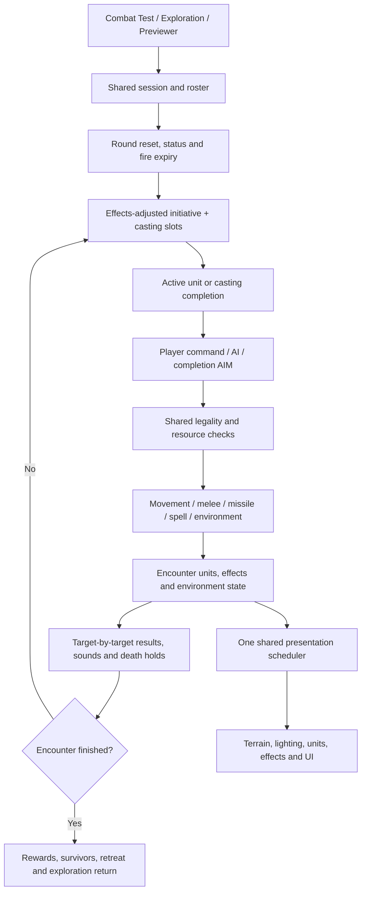

# Combat architecture and extension guide

Local cleanup build R238C293. Updated November 5, 2026. Publishing remains pending user authorization.

## Ownership

| Responsibility | Owner | Inputs and dependencies |
| --- | --- | --- |
| Launch/configuration, shared catalogs and UI bindings | adventure-party.js | Authored data, equipment, UI controls; retains shared bindings |
| Session initialization/results/exit | combat-session-state.js and combat-runtime.js | Scenario/roster, rendering readiness, exploration return; owns encounter transitions |
| Rounds, initiative, active-unit progression | combat-turn-flow.js | Units, status services, casting lifecycle, result holds, shared frame scheduler |
| Casting records and completion | combat-casting-lifecycle.js | Initiative, resource services, legal-target selection; no independent rendering loop |
| Public action admission | longbowAttack/slingAttack/castPreparedCombatSpell in adventure-party.js | Environmental target validity before costs/effects |
| Melee and sweep | combat-melee-actions.js | Explicit result context → melee sound → Slow → perception → physical hit resolver |
| Missile resolution | combat-missile-actions.js | Explicit result context → protection → bow/sling hit resolver; common equipment/ammo and impact services |
| Movement/footprints/pathfinding | combat-movement.js | Occupancy and wall/door geometry; reactions before movement commit; area effects/guards afterward |
| Opportunity attacks, Guard/Ranged Ambush | combat-reactions.js | Existing reach and previous-target rules, shared attack entry points |
| Prepared-spell orchestration | combat-spell-actions.js | Sound → caster focus → completion cleanup → casting context → dispatch |
| Spell families | combat-spells-damage.js, combat-spells-control.js, combat-spells-support.js | Existing spell commit/resource and result services; level-3 extensions remain named registered stages |
| Persistent environment | combat-environment-state.js, combat-environment-actions.js | Doors/windows, blocked edges, scorch, arrows and fire lifecycle; shared encounter data |
| Visibility | combat-visibility.js | Friendly observers, geometry, fog; CPU gameplay authority |
| Targeting/area selection | combat-targeting.js | Visibility and projectile obstruction; intact glass remains visible but untargetable beyond it |
| Frame composition | combat-render-frame.js | Read presentation state, queue terrain/actors/effects through shared scheduler |
| Terrain/architecture and unit drawing | combat-render-surfaces.js, combat-render-units.js | Lighting/exposure, assets and projection; drawing does not decide attack legality |
| Lighting and effects | combat-lighting-services.js, combat-effect-animation.js | Shared light/effect sources, shader backend and existing animation scheduler |
| GPU resources | combat-webgl.mjs and existing specialized renderers | WebGL 2, geometry, sampling/compositing; no combat-rule ownership |
| Legacy extension composition | combat-services.js | Named ordered stages, stable facades and captured previous implementations |

## Persistent combat loop

## Service boundaries and remaining shared state

This is a classic-script modularization, not a conversion to isolated ES modules. The game, terrain, catalogs, UI and presentation bindings still share the existing engine scope. Ownership is explicit; complete dependency injection is not claimed. The extraction audit in combat-module-manifest.json records 208 function bodies and their owners. Tests verify those bodies are unchanged (the physical melee implementation was renamed behind its stable entry).

Legacy extensions now call AdventurePartyCombatServices.register(name, stageId, implementation). A stage captures its predecessor using current(name), never the live public facade. Registration preserves original manifest order, detects duplicate IDs and keeps public identity stable after first registration. inspect() exposes the installed order for diagnostics. combat-service-stages.json inventories the 198 migrated stages across 125 services. These stages retain their historical closures; the registry does not pretend their implementation dependencies have disappeared.

Primary turn, missile, spell orchestration and casting transitions use direct named calls. Prefer a direct owner change for new work. Use a registered stage only where a genuine extension boundary is needed; never add another bare function reassignment. Do not capture the facade as a predecessor or install a new frame loop.

## Adding features

- New weapon: use equipment/catalog and shared eligibility/ammunition rules; enter the existing melee or missile action owner.
- New spell: add its resolver to the appropriate family and dispatch through the prepared-spell owner. Keep AI, battlefield and Previewer on the same production path.
- New environment object: persistent encounter state belongs to the environment owner; separately define movement, sight, targeting and presentation behavior.
- New visual: read the existing scene/effect state and use the shared frame scheduler. CPU LOS/targeting remains authoritative.
- New encounter route: feed a scenario to startCombatSession; do not fork combat initialization or result handling.

## Validation

The full test sweep uses work/run-cleanup-tests.cjs; its JSON report is work/combat-cleanup-test-results.json. New core checks include test-combat-module-boundaries, test-combat-turn-flow, test-combat-casting-lifecycle, test-combat-spell-actions, test-combat-missile-actions and test-combat-action-entry. Legacy extraction tests read current owners through scripts/combat-test-source.mjs rather than retaining dead copies in the main file. Startup validation uses the real ordered manifest.

Two final-suite issues were resolved separately: Falling correctly borrows the documented one-handed Ready pose; Wizard Staff explicitly refuses implicit weapon-pose fallback. Sprite-package temporary files now live in the workspace, and its path-safety test uses a Windows junction (directory symlink on other systems). Windows sandbox policy can still require running that one fixture outside the sandbox; no safety assertion is skipped.

Browser validation results and final test totals are recorded in COMBAT_CLEANUP_CHECKPOINT.md. Player visual QA and publishing are separate from automated/browser smoke validation.

### Shared projected shadows (local prototype, 2026-11-05)

See PROJECTED_SHADOWS.md. combat-projected-shadows.mjs is a renderer-owned GPU pass; lighting services adapt physical casters/emitters, unit-sun-shadow supplies cached alpha/foot contacts, and the frame owner schedules ground shadows before scenery. CPU gameplay visibility/targeting remains authoritative.
