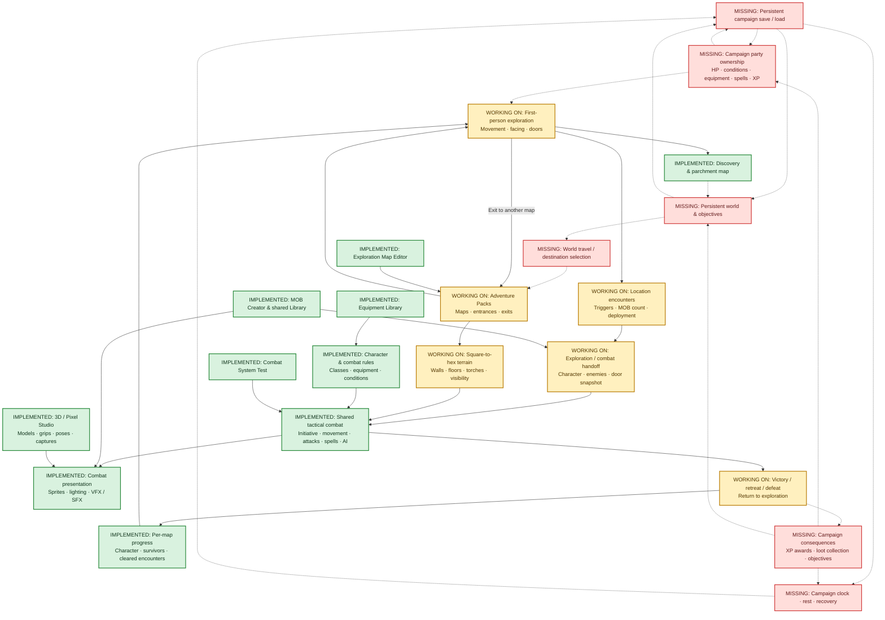

# Persistent game loop — recovery checkpoint

Recorded 2026-10-31 at the user's request. Include this document in the next repository push. This is a reconstruction from code reviewed at candidate commit 767d3a600bd31610957295f0faa9f47e7e000872, not a recovered transcript.

## Baseline and intent

PR #330 restored the exact tracked tree of Candidate Rev 220 (original commit a71c20e53260d6a7f0ea886407a27f25ec630275). Validation and publication succeeded. The restored tree SHA is eb332a5ef7421ef4335d7416c92734998af0206f. This local checkout was older when this document was prepared; do not treat its existing code as the current candidate baseline.

The user confirmed the architectural gist: a persistent party travels between locations, explores in first person, enters tactical combat within the same geography, and carries consequences back into the ongoing adventure. The missing recent chat concerned exploration/combat mechanics and the return to Rev 220. Do not assume its undocumented decisions have been recovered.

## Status legend

- Green: implemented subsystem or connection; not a claim of complete feature coverage or final player QA.
- Amber: current development focus, with working foundations and unfinished integration/refinement.
- Red: missing persistent-game capability.
- Solid arrows: implemented connections. Dotted arrows: required future connections.
- Status describes the reviewed Rev 220 snapshot and the user's stated work focus, not live work by another agent.

## Architecture

## Verified implementation boundaries

- World Map Maker and Combat Map Maker launcher entries are not connected. Connected local maps exist through Adventure Packs and editor-test transitions.
- Exploration maps are 8–128 cells per dimension, ten feet per authored square. First-person movement tracks one party position and cardinal facing, doors and discovery.
- Encounters are authored trigger regions with one selected MOB type and 1–6 opponents. Random encounters and mixed encounter groups are not implemented by this bridge.
- Combat reuses the existing production engine, factories, rules and asset renderer. It crops terrain five exploration squares around the encounter origin. Rev 220 conversion is one tactical hex width per exploration square; world-distance reconciliation should not be presumed complete.
- Rev 220 retains compact tactical walls (35px high), solid footprints and visible merged top caps. Wall boundaries govern movement, sight and light. Combat doors are not interactive.
- The exploration combat roster is one character, normally Carl, with no allies supplied by the bridge. Existing combat ally support is not a persistent campaign party.
- Entry and explicit return save character/enemy snapshots. Retreat preserves survivors and returns to the previous exploration square. Victory clears the encounter and returns to its trigger position. Defeat requires restart.
- Normal progress is browser-local and scoped to map geometry/encounter definitions; editor tests use isolated session storage. There is no shared campaign party across maps and no continuous mid-round save.
- Victory records loot, but exploration loot collection and campaign XP award are unfinished. The exploration return path exits finishCombat before standalone XP/reward handling.
- Campaign ownership should ultimately encompass party, inventory, conditions, advancement, location, discoveries, encounter outcomes, time and objectives. This is an architectural interpretation, not an approved implementation specification.

## Source map

- js/exploration-authoring.mjs: Adventure Packs, map validation and links.
- js/exploration-core.mjs: movement, facing and doors.
- js/exploration.mjs: first-person runtime, discovery updates, encounter and exit navigation.
- js/exploration-discovery.mjs / exploration-map.mjs: visibility memory and parchment.
- js/exploration-encounters.mjs: triggers, progress records and terrain conversion.
- js/exploration-encounter-client.mjs: outbound handoff and exploration restore.
- js/exploration-combat-hooks.js: production engine integration, deployment and return snapshots.
- js/adventure-party.js: shared combat, newGame, startRound, finishCombat and launcher routing.
- docs/EXPLORATION_EDITOR.md / EXPLORATION_ENCOUNTERS.md: implementation history and limits.

## Next-session continuity

Read this alongside AGENTS.md and docs/DEVELOPMENT_WORKFLOW.md. Verify current candidate before editing; preserve existing systems rather than creating parallel combat or rendering implementations. Include this checkpoint in the next feature/fix PR and push; it has not been remotely published merely by being written locally.

## Follow-up: reference combat-map baseline

The user rejected the Rev 220 visual result and supplied a screenshot showing compact wall faces and black unseen areas, asking to revert map LOS to that baseline before further fixes. Rev 224 restores the pre-solid-cap Rev 219 exploration rendering path. Screenshot correspondence remains a visual comparison, not recovered transcript evidence. The prior Rev 220 restoration was technically published but did not satisfy the user's intended map appearance.

## Rev 225 continuation

Colored multi-square encounter areas now support partial/bulk removal and Undo. Exploration-to-combat conversion is 1:2 in the floor plane, keeping compact 35px walls. This supersedes the earlier 1:1 description. Campaign party ownership and rewards remain unfinished.

## Rev 226 continuation

User requested combat material quality, scale and lighting closer to the supplied first-person exploration reference. Combat source detail, wall texture proportions and warm lighting were adjusted while preserving Rev 225 area encounters, 1:2 geometry and compact 35px walls. See EXPLORATION_ENCOUNTERS.md for rendering specifics.

## Rev 227 continuation

The user rejected Rev 226 as a visual mismatch: compact walls must show six brick rows, floor scaling must match authored exploration slabs, and independent combat lighting was inadequate. Rev 227 introduces exploration-scene-style.mjs and the two rendering adapters described in SHARED_SCENE_STYLE.md. Separate tactical footprint from aspect-preserving artwork for doors/windows/props. Preserve 1:2 spacing and compact 35px wall geometry. Shared lighting includes the previously missing combat party lantern.

## Rev 228 continuation

User identified the blocked standing hex in front of a closed door. Whole-door-tile blocking is removed in favor of the architectural plane. A player-controlled two-point THROUGH DOOR [F] command crosses an open snapshot doorway between aligned standing hexes, skipping intermediate corner cells. Closed-door interaction remains future work. Floor slabs halve in both axes and bricks halve in width; six rows and 35px walls remain.
